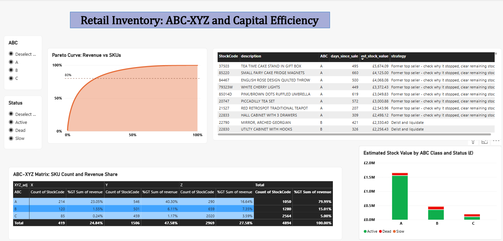
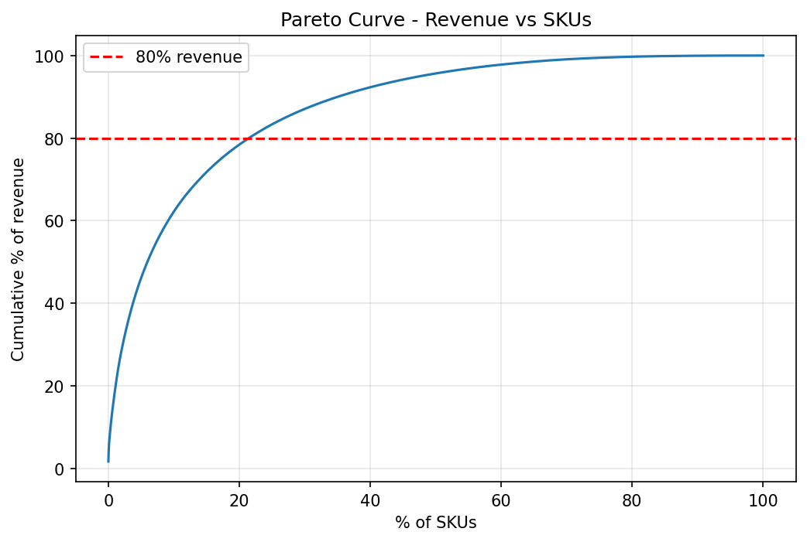
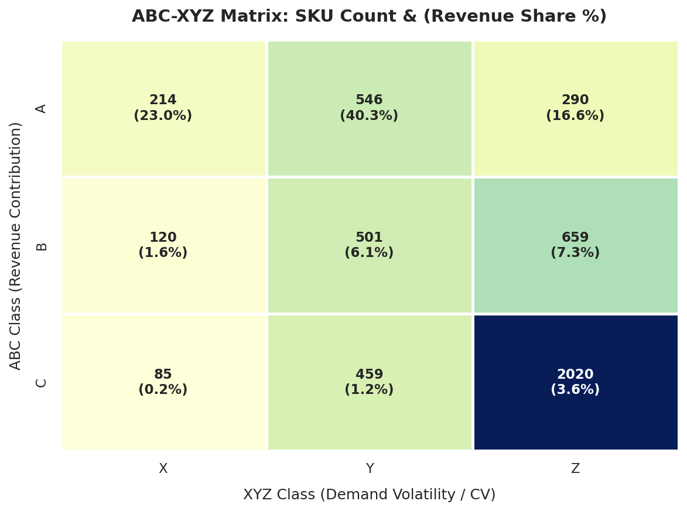
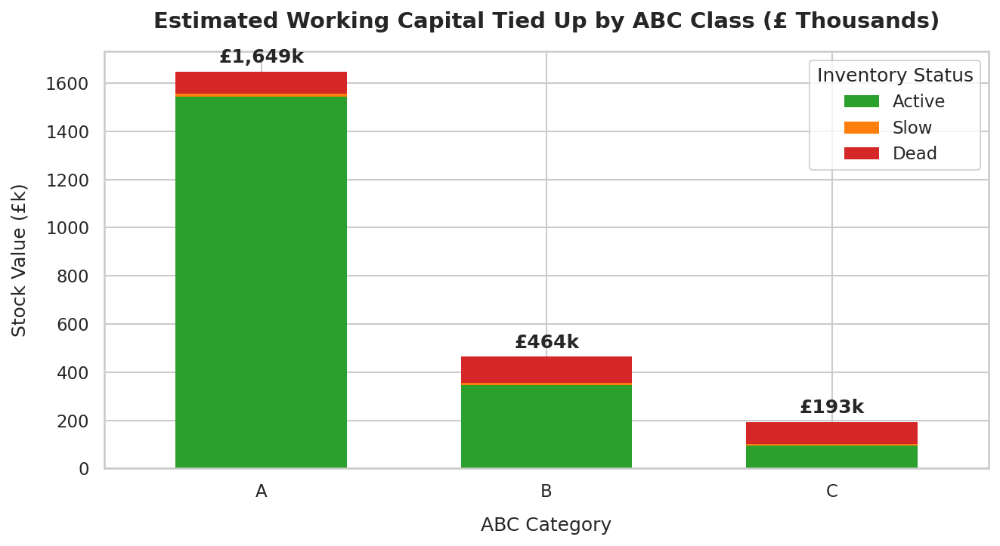

# Retail Inventory Classification & Capital Efficiency Analysis

ABC-XYZ classification of ~1M retail transactions to find where inventory capital is tied up, and which SKUs to control tightly, review, or delist.

**Tools:** Python (pandas, NumPy, matplotlib, seaborn), SQL (T-SQL, SQL Server), Power BI, Jupyter

## Business problem

Retailers tie up cash in stock that does not sell, while best-sellers risk stock-outs. This project:
1. Classifies SKUs by revenue contribution (ABC) and demand variability (XYZ)
2. Estimates the capital locked in dead, slow and non-seasonal stock
3. Recommends a stocking strategy for each class and estimates the capital that could be freed

## Data

UCI **Online Retail II** (UK online gift retailer): 1,067,371 invoice lines, 1 Dec 2009 to 9 Dec 2011, 5,305 raw StockCodes. Values are in GBP.

## Method

1. **Cleaning:** removed 34,335 exact duplicates, cancelled invoices (prefix "C"), rows with non-positive quantity or price, non-product codes (postage, fees, adjustments, test codes), gift vouchers, and two large orders that were later cancelled (the cancellation rows were already dropped). Final: **1,003,338 rows, 4,894 SKUs**.
2. **ABC (Pareto):** SKUs ranked by revenue. A = top 80% of revenue, B = next 15%, C = last 5%.
3. **XYZ:** coefficient of variation (CV) of monthly demand. X ≤ 0.5, Y ≤ 1.0, Z > 1.0. Dec 2011 is excluded as a partial month.
4. **Lifecycle adjustment:** CV is measured only between a SKU's first and last month of sale, so launches and discontinuations do not look like erratic demand. SKUs with under 3 months of life (469) are treated as Z.
5. **Dead / slow stock:** days since last sale at the data snapshot (9 Dec 2011). Dead = 180+ days, Slow = 90 to 179, Active = under 90.
6. **Seasonality filter:** a SKU is seasonal if 70%+ of its units fall in its 3 best calendar months, it has at least ~1 year of history, and at least 6 orders.
7. **Capital model:** estimated stock value = average daily demand × 90 days of cover × unit-weighted price × 60% cost ratio.
8. **Strategy mapping, capital freed and reorder points** per ABC-XYZ class and status.

## Key findings

| Finding | Result |
|---|---|
| Pareto concentration | 21.5% of SKUs (1,050 of 4,894) generate 80% of revenue |
| Tail | 52.4% of SKUs (2,564) generate only 5% of revenue |
| Total revenue (cleaned) | about £19.4M |
| Erratic (Z) SKUs | 82% before lifecycle adjustment, 61% after |
| SKUs with no sale in 90+ days | 1,670 of 4,894 (34%) |
| Total modelled stock value | about £2.31M |
| Capital locked in dead + slow stock | about £321K, 13.9% of modelled stock value |
| Excluding strictly seasonal items | about £290K, **12.6%** (base case) |
| Sensitivity | 10.9% to 13.9% across 90 to 270 day thresholds; 6.7% under a looser seasonal definition |
| Estimated capital freed | about £331K (14.4% of modelled stock value) |

Capital freed = £145K from liquidating dead/slow non-seasonal stock + £186K from cutting cover on stable (X) active items.

### Charts

### Locked capital by class

| Class | Dead + slow capital | Share of that class's capital | Share of all locked capital |
|---|---|---|---|
| A | £103,666 | 6.3% | 32.3% |
| B | £119,230 | 25.7% | 37.1% |
| C | £98,134 | 50.8% | 30.6% |

**Other observations**
- Locked capital is spread across all three classes: B holds the largest share (about 37%), followed by A (about 32%) and C (about 31%).
- C-class has the worst dead-stock rate: about 51% of its modelled capital sits in dead or slow SKUs, against 26% for B and 6% for A.
- AX and AY items (760 SKUs) hold about 63% of revenue, so stock-outs there cost the most.
- 76 dead or slow A-class SKUs were former top sellers that stopped selling. They look like discontinued lines and are worth investigating.

## Strategy by class

| Strategy | SKUs |
|---|---|
| Delist and liquidate | 1,278 |
| Order on demand, consider cutting from range | 986 |
| Standard reorder point, periodic review | 501 |
| Regular review, moderate safety stock | 500 |
| Small batches, review range | 492 |
| Seasonal: order to forecast before season | 316 |
| Bulk and infrequent ordering | 279 |
| Higher safety stock, monitor demand closely | 261 |
| Tight control, frequent replenishment, low safety stock | 205 |
| Former top seller: check why it stopped, clear remaining stock | 76 |

## SQL cross-check

The SKU aggregation, ABC classification and dead/slow flag are reproduced in T-SQL (SQL Server) in the `sql/` folder, using window functions for the cumulative revenue share. Results match pandas to within one SKU: SQL gives 4,893 SKUs against 4,894 in pandas, and one dead C-class SKU is merged with another code. SQL Server ignores trailing spaces in text comparison, which is the likely cause (not confirmed).

## Assumptions and limitations

The dataset has no stock levels or cost prices, so the capital figures are **modelled estimates**, not measured balances.

- Unit cost = 60% of selling price
- Average price per SKU is unit-weighted (revenue ÷ units), so bulk orders at low prices are valued correctly
- Stock held = 90 days of average demand (demand rate over each SKU's life, minimum 90 days)
- For dead SKUs, the figure is the capital exposed had they been stocked normally, not an observed balance
- Liquidation recovers 50% of cost value
- X-class active items can run on 60 days of cover instead of 90
- Cut-offs (80/15/5, CV 0.5/1.0, 90/180 days, 70% seasonal share) are common conventions, not rules
- Returns and cancellations are excluded, which slightly overstates revenue

The percentage figures (e.g. 12.6%) are more robust than the pound figures, because the cost ratio and cover days scale every SKU equally. The dead/slow thresholds and the seasonal definition do change the percentage, which is why the sensitivity range is reported.

### Reorder points

Safety stock and reorder points are calculated for active SKUs with at least 3 months of sales history (3,061 SKUs):

- Safety stock = Z × (monthly demand std × √(lead time in months)), with Z = 2.05 / 1.65 / 1.28 for A / B / C (98% / 95% / 90% service level)
- Reorder point = demand during a 14-day lead time + safety stock
- Dead, slow and short-life SKUs get no reorder point

These are indicative. The formula assumes roughly normal demand, so very lumpy or seasonal SKUs (for example Christmas items and wholesale tissue packs) get large buffers. In practice these would be reviewed manually or ordered ahead of season.

## Project status

**Completed**
- Data cleaning and outlier handling
- ABC (Pareto) and lifecycle-adjusted XYZ classification
- Dead, slow and seasonal stock analysis, with threshold sensitivity
- Capital locked and capital freed estimates
- Strategy mapping per class
- SQL (T-SQL) reproduction of the core steps, cross-checked against pandas
- Safety stock and reorder point calculation
- Power BI dashboard (Pareto curve, ABC-XYZ matrix, capital by class, delist candidates)

## Repository contents

- `notebook.ipynb`: full analysis
- `sku_analysis_final.csv`: SKU-level output (class, status, strategy, estimated stock value, reorder points)
- `sql/`: T-SQL scripts (`01_sku_summary.sql`, `02_abc_classification.sql`, `03_dead_slow_flag.sql`)
- `dashboard.pbix` and `dashboard.png`: Power BI dashboard and screenshot
- `pareto.png`, `abc_xyz_heatmap.png`, `capital_by_class.png`: charts from the notebook

## Reproduce

1. Download `online_retail_II.xlsx` from the UCI repository and set the `folder` path in the first notebook cell
2. `pip install pandas numpy matplotlib seaborn openpyxl jupyter`
3. Run all cells top to bottom (the first run converts the Excel file to CSV, which takes a few minutes)
4. For SQL: import `online_retail_clean.csv` (written by the notebook) into SQL Server as `online_retail_clean`, then run the scripts in `sql/` in order
